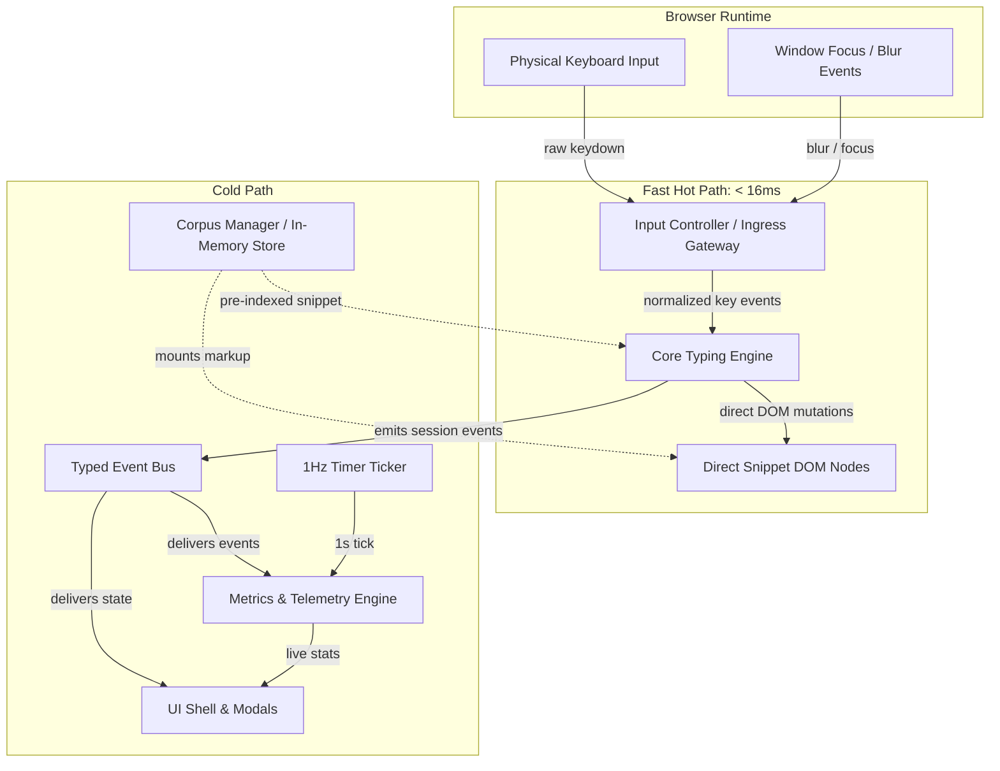
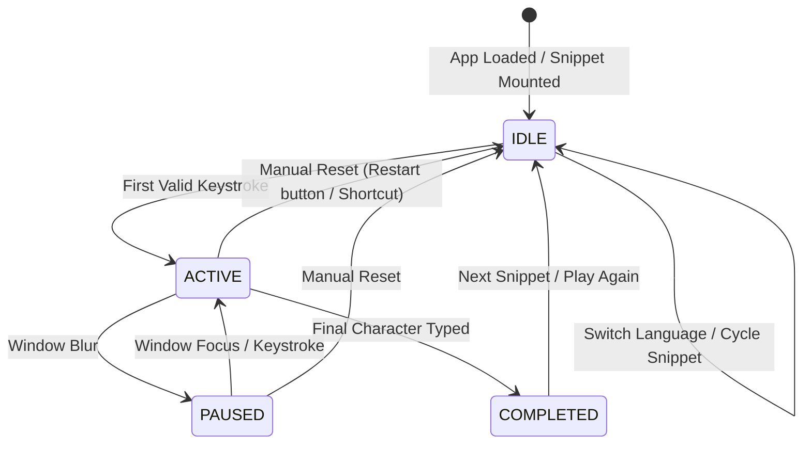

# TypeForge — High-Level Design (HLD) & System Architecture

## 1. Executive Summary & Architectural Goals
TypeForge is a specialized, zero-lag browser typing engine tailored for competitive programmers and software engineers. The architecture is engineered around the critical non-functional requirement:
- **Hot-Path Keystroke-to-Paint Latency**: Strict budget under **16ms** (1 single 60Hz frame).
- **Execution Model**: **100% in-memory client-side loop** with zero network jitter during active typing.
- **Ergonomics**: IDE-grade auto-indentation, atomic backspace rollback, and non-blocking error flow.

---

## 2. High-Level Architecture (Data Plane vs. Control Plane)

The system enforces strict architectural decoupling between high-frequency typing execution and lower-frequency UI/metrics telemetry:

---

## 3. Core Component Boundaries

### 3.1 Input Controller (Ingress Gateway)
- Captures raw browser keyboard events (`keydown`).
- Filters out standalone modifier keys (`Shift`, `Control`, `Alt`, `Meta`, `CapsLock`) and function keys (`F1`-`F12`).
- Intercepts default browser behaviors (e.g. `Tab` navigation, `Space` scrolling).
- Translates focus/blur events to pause/resume commands.

### 3.2 Core Typing Engine (Data Plane)
- Maintains active in-memory session state: `cursorIndex`, `currentLine`, `errorCount`, `uncorrectedErrors`.
- Operates directly on pre-rendered DOM character spans (`span[data-idx]`), applying CSS classes (`.correct`, `.incorrect`, `.indent-skipped`, `.caret`).
- Executes in under **1.5ms** on the JS thread without triggering virtual DOM reconciliation or tree diffing.
- Provides atomic rollback on backspace across auto-indented lines.

### 3.3 Metrics Engine (Control Plane)
- Operates asynchronously from the typing hot loop.
- **Live Cadence (1Hz)**: Computes live Net WPM and Accuracy every 1,000ms. Applies a **3-second warm-up window** (displaying placeholder `—`) to prevent early fractional-second number jitter.
- **Final Snapshot**: Evaluates precision Net WPM and keystroke accuracy on snippet completion using `performance.now()`. Deducts all accumulated window-blur pause durations.

### 3.4 In-Memory Corpus Manager
- Bundles curated competitive programming snippets in Java and Python (Binary Search, Two Pointers, BFS/DFS, Trie, Dynamic Programming).
- Pre-indexes each snippet at mount time into `IndexedLine` metadata to provide **O(1)** auto-indent lookups.
- Employs a **Random Shuffle** selection strategy to prevent repetitive muscle memory memorization.

### 3.5 UI Shell & Overlays
- Renders top navigation (language toggle, live metric cards, elapsed timer).
- Manages full-screen pause overlay on blur.
- Renders post-session Results Modal with rapid cycling CTA ("Next Snippet" via `Enter` / `Tab + Enter`, "Retry" via `Esc`).

---

## 4. Session State Machine

The typing session follows a deterministic 4-state lifecycle:

---

## 5. Event Bus Contracts

Communication across component boundaries uses a typed Pub/Sub event emitter:

| Event Name | Emitted By | Payload | Purpose |
| :--- | :--- | :--- | :--- |
| `SESSION_STARTED` | Core Engine | `{ startTime: number, snippetId: string }` | Initializes timers and resets metrics collectors. |
| `KEYSTROKE_PROCESSED` | Core Engine | `{ index: number, isCorrect: boolean, char: string }` | Updates metrics counters without blocking render. |
| `SESSION_PAUSED` | Input Controller | `{ pausedAt: number }` | Freezes metrics ticker and displays blur overlay. |
| `SESSION_RESUMED` | Input Controller | `{ resumedAt: number, pauseDuration: number }` | Restarts ticker and accumulates pause delta. |
| `SESSION_COMPLETED` | Core Engine | `{ endTime: number, totalKeystrokes: number, finalErrors: number }` | Triggers final metrics snapshot and opens Results Modal. |
| `METRICS_TICK` | Metrics Engine | `{ liveWpm: number \| null, accuracy: number, elapsedSec: number }` | Updates top-bar dashboard once per second. |

---

## 6. Architectural Decision Summary

| ADR ID | Decision Title | Selected Strategy | Core Rationale |
| :--- | :--- | :--- | :--- |
| **ADR-001** | Architecture & Stack | Hybrid (Isolated Direct-DOM Core + Declarative Shell) on Vite + TS | Protects < 16ms budget by avoiding VDOM diffing on the hot path while structuring UI shell cleanly. |
| **ADR-002** | Telemetry Architecture | Typed Event Bus (Pub/Sub) | Completely decouples keystroke execution from downstream metrics and UI overlays. |
| **ADR-003** | Metrics & Indentation | Output-based indent credit + 3s warm-up window | Matches IDE developer ergonomics and eliminates early fractional-second WPM jitter. |
| **ADR-004** | Backspace Ergonomics | Atomic Indentation Rollback | Jumping back over leading whitespace to previous line preserves coding rhythm. |
| **ADR-005** | Completion UX | Rapid Snippet Cycling ("Next Snippet" default) | Maximizes continuous CP drill throughput. |
| **ADR-006** | Corpus Storage | Pre-indexed lines + Random Shuffle | O(1) auto-indent lookup on Enter; varied algorithm practice. |
